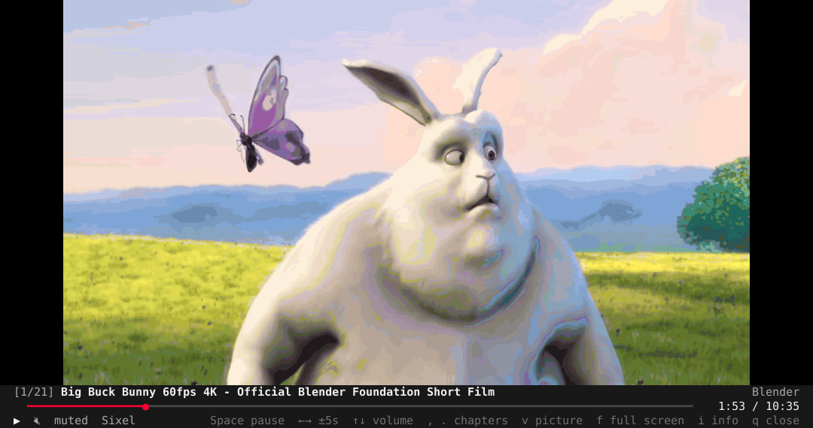
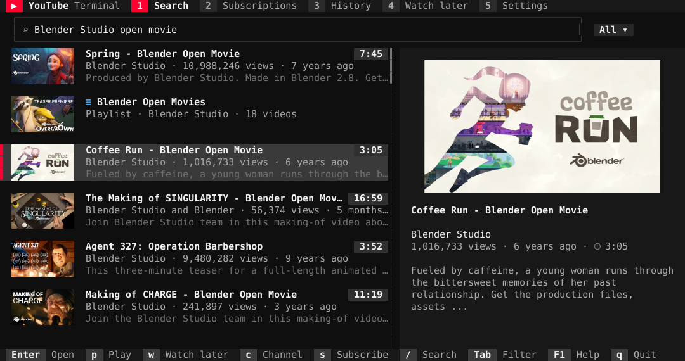

<div align="center">

# ▶ YouTube Terminal

**YouTube in your terminal — search, channels, playlists, comments and real video playback with sound.**<br>
One self-contained file for Windows, Linux and macOS. Nothing to install.

[](https://github.com/dkinvoker/YoutubeTerminal/actions/workflows/build.yml)
[](https://github.com/dkinvoker/YoutubeTerminal/releases/latest)



</div>

## Features

- 🔎 **Search** with suggestions, filters (videos, channels, playlists) and sorting — or just paste any YouTube link.
- 📺 **Channels, playlists and mixes**, plus video pages with description, chapters, comments and related videos.
- ▶️ **Video playback right in the terminal**, in sync with the sound: full Sixel graphics, Unicode octants or colored half blocks.
- 🔴 **Live streams**, autoplay, a play queue and resume where you left off.
- ⭐ **Your library, stored locally:** subscriptions with a "latest videos" feed, watch history and Watch later.
- ⌨️ **Keyboard first**, with mouse support for scrolling, clicking and seeking.
- 🌍 **English and Polish** interface.
- 📦 **A single executable.** No .NET, Python or ffmpeg to set up, and a one-click uninstaller that leaves nothing behind.

<div align="center">

</div>

## Download

Grab the file for your system from the [latest release](https://github.com/dkinvoker/YoutubeTerminal/releases/latest):

| System | File |
| --- | --- |
| Windows 10 / 11 (x64) | [`YoutubeTerminal-win-x64.exe`](https://github.com/dkinvoker/YoutubeTerminal/releases/latest/download/YoutubeTerminal-win-x64.exe) |
| Linux (x64) | [`YoutubeTerminal-linux-x64.tar.gz`](https://github.com/dkinvoker/YoutubeTerminal/releases/latest/download/YoutubeTerminal-linux-x64.tar.gz) |
| Linux (ARM64) | [`YoutubeTerminal-linux-arm64.tar.gz`](https://github.com/dkinvoker/YoutubeTerminal/releases/latest/download/YoutubeTerminal-linux-arm64.tar.gz) |
| macOS (Apple Silicon) | [`YoutubeTerminal-macos-arm64.tar.gz`](https://github.com/dkinvoker/YoutubeTerminal/releases/latest/download/YoutubeTerminal-macos-arm64.tar.gz) |

**Windows:** run the `.exe` in [Windows Terminal](https://aka.ms/terminal).

**Linux and macOS:** unpack and run it from your terminal.

```bash
tar -xzf YoutubeTerminal-linux-x64.tar.gz
```

```bash
./YoutubeTerminal
```

On macOS, a file downloaded with a browser may be blocked as coming from an unidentified developer. To allow it:

```bash
xattr -d com.apple.quarantine YoutubeTerminal
```

You can also start straight from a search or a link:

```bash
./YoutubeTerminal "lofi hip hop"
```

## Best terminals

| Picture | Terminals |
| --- | --- |
| **Sixel** (full graphics) | Windows Terminal 1.22+, WezTerm, foot, Konsole, iTerm2, xterm (`-ti vt340`), mlterm |
| **Octants** (2×4 pixels per cell) | Windows Terminal 1.25+, or any terminal and font with Unicode 16 octant glyphs |
| **Half blocks** | Any terminal with 24-bit color |

The app picks Sixel automatically when your terminal supports it. Press `v` during playback to switch modes,
or choose one in **Settings** (`5`). If playback stutters, try octants or lower the video size in Settings.

## Keys

| Key | Action |
| --- | --- |
| `1`–`5` | Search · Subscriptions · History · Watch later · Settings |
| `Enter` / `p` | Open / play |
| `a` | Play audio only |
| `c` · `s` · `w` | Go to channel · subscribe · add to Watch later |
| `Space` | Pause |
| `← →` · `j l` | Seek 5 s · 10 s |
| `↑ ↓` · `m` | Volume · mute |
| `v` · `f` | Picture mode · full screen |
| `Esc` / `q` | Back |
| `F1` | All shortcuts |

## Uninstall

The first run puts an uninstaller next to the program: `uninstall.cmd` on Windows, `uninstall.sh` on Linux and macOS.
It removes the program, its data, the bundled tools and itself. You can choose to keep your subscriptions and history.

## Under the hood

YouTube Terminal is written in C# and compiled with .NET Native AOT into a single native executable.
It uses the bundled [yt-dlp](https://github.com/yt-dlp/yt-dlp) to find video streams and decodes them with
Media Foundation on Windows or [FFmpeg](https://ffmpeg.org) on Linux and macOS (your system's copy, or a small bundled one).
The terminal UI, the Sixel and octant encoders and the video player are written from scratch.

Building from source, settings, file locations and the release process are described in the
[technical documentation](docs/dokumentacja.md) (in Polish).

## Credits

- [yt-dlp](https://github.com/yt-dlp/yt-dlp) (Unlicense), [FFmpeg](https://ffmpeg.org) (LGPL 2.1+, Linux and macOS builds), [StbImageSharp](https://github.com/StbSharp/StbImageSharp).
- Screenshots show *Big Buck Bunny* and other [Blender Studio](https://studio.blender.org) open movies (CC BY).
- This project is not affiliated with YouTube or Google.
